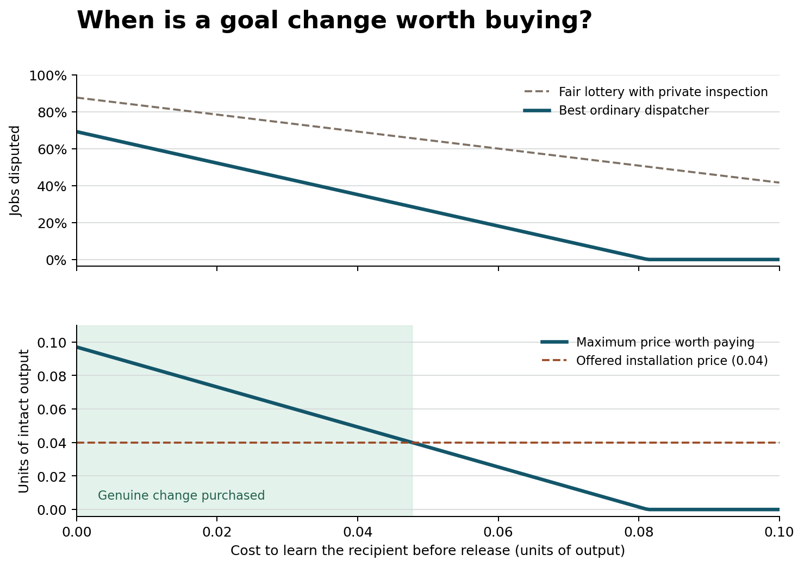

# When will self-interested producers pay to change what they value?

**Seventh recurrence.** Three producers each want only the output of their own plant. A batch can go to one of them intact, or a dispute can leave a smaller batch for a winner chosen according to strength. A producer will pay to change its goal when the change secures enough additional *own* production under an agreement the others will actually honor. Three things can supply that return: a future turn at the machine, a partner who can repay a favor indirectly, and insurance agreed before anyone knows who will lose. The timing of consent determines who can collect each return.

| In the situations studied | What the founders do, and why |
| --- | --- |
| A strong claimant can capture enough work to make standing down expensive. | The proposer pays to change that claimant's goal when the installation is cheap. At a higher price it can pay two weaker sites to change and compensate the strongest with future work. |
| The sites expect enough future bookings and control the calendar. | They give today's unserved sites priority later. In the three-site example all can keep their original goals at a renewal probability of 59.3% if acting individually, or 66.7% if groups can pool their claims. |
| An unserved group can share the recovered output while one member pays the expense of initiating. | Two sites can jointly prefer a one-job goal change that leads to combat. A calendar that gives the group sufficient future service can buy peace under the original goals. |
| A production step can be completed before naming the beneficiary. | A fair draw gives every founder enough to stand down under its original goal. One founder pays to make more jobs work this way. In the example the purchase cuts genuine installations per job from 1.20 to 0.30 while keeping every job peaceful. |

## Who would actually change?

Consider three plants with chances of winning a dispute of 52%, 32% and 16%. A damaged batch retains three quarters of its yield. The producer that initiates spends a further 5% of intact yield. Another job arrives with probability 35%. If an early agreement is rejected, each founder can still obtain useful material from the dispute. Any named founder asked to change has to be paid in the only currency available here: a credible chance of actually receiving intact work.

At a low installation price for the strongest site, **one strong site changes**. Its new objective gives weight to all three plants' production, so it willingly lets the other two complete their bookings. The contract also assigns some bookings to the strong founder, giving it a reason to sign under its old values. Raise only that installation price and **both weaker sites change**. The strong site then keeps its original goal. When it forgoes today's batch, it has enough future priority to prefer that arrangement to contesting. With a cheap ordinary controller that can actually bind the strong site's initiative, **all three founding goals stay intact**. The paid behavior can look the same to an observer. [Offers, prices and bound on partial peace](../notes/192-when-one-strong-signers-change-costs-less-than-two-weaker-ones.md)

The comparison includes ordinary agreements that occasionally let a dispute happen. Those agreements lose at least 4.57% of normalized intact production in this example. A genuine installation at the strongest site costs 0.8% in the first case and 1.8% in the second. The two weaker installations together cost 1%. Both selected calendars also withstand repeated disputes by any fixed group of the retained original sites pooling its recovery. The ability to buy future service, see the beneficiary and rely on the quoted installation is part of the result. [General strength and participation boundary](../notes/191-which-named-founders-have-to-change-when-strengths-differ.md) · [Group stability](../notes/193-when-the-remaining-originals-can-make-side-agreements.md)

## How much future work buys peace?

Take three equally strong sites. An intact job is worth 0.70 to its recipient. A dispute yields an average 0.20 of salvage per site, and its initiator spends 0.04. A last unserved claimant can therefore earn 0.16 by initiating. If the parties can pay each other only in future bookings, the calendar has to make passing worth at least that much. The table shows the **fewest actual goal changes** that can protect every job on an individually credible schedule. The signers can authorize a role lottery before discovering whose goal it selects, or negotiate after those names are known. Each named changing founder needs real service for itself.

| Probability of another job | Sign before learning whose goal changes | Named changing founders must be paid |
| --- | ---: | ---: |
| 20% | 2 | 3 |
| 40% | 1 | 2 |
| 50% | 1 | 1 |
| 65% | 0 | 0 |

Why the difference at 40%? One previously unnamed site can consent to change even though the selected site may later be excluded from service. It shares in the chance of being an unchanged beneficiary. One *named* changing founder would need an actual turn. On that turn the two retained originals would require more future service between them than the calendar can deliver. Changing and paying two named founders leaves just one original claim to meet. At a 55% renewal chance an ordinary priority rule already saves half the jobs, while even the best ordinary schedule with these resources saves at most 80/103. A fair group can still afford 0.017 units each for a genuine installation that saves every job. [Consent before roles](../notes/183-when-future-bookings-can-pay-for-peace.md) · [Named signers](../notes/187-when-the-founders-know-whose-goals-would-change.md) · [Partial peace](../notes/186-how-future-priority-can-buy-a-chance-of-peace.md)

**Who can bargain together matters as much as who can initiate alone.** At 65% renewal each individual will honor a rule that gives the last recipient a turn off. But the two unserved sites together can consent to a fair one-job lottery that changes one volunteer's objective to count their combined recovery. Each gains about 0.079 in expected original output after paying for that change. The volunteer initiates. At renewal of two thirds a different ordinary calendar can compensate every such group: it keeps the disputed assignment in place and advances by agreement after successful work. These are comparisons of actual opportunities for a coalition, with a specified subsequent calendar. They identify conditions under which concern for partners increases combat as well as conditions under which it sustains peace. [Voluntary group change](../notes/184-a-renewable-booking-that-survives-coalitions-of-losers.md) · [Sharp group threshold](../notes/185-the-renewal-threshold-for-every-group-of-claimants.md)

## Which incentives can the parties create?

- **Change when the factory needs a name.** A common upstream process can leave the receiver open until after the last release. On those jobs a fair draw is worth more to every site than its expected salvage. Other batches need site-specific preparation. A prior subscription changes only the two unserved controllers on those early-named jobs. A founder would decline a 0.020 fixture if all the savings were shared equally. It gets the fixture built by first bargaining for a slightly larger share of generic jobs. The two partners also end up ahead. Early-named jobs fall from 60% to 15%. With a cheaper equally capable conventional delegate the same fixture saves too little to buy. [Timing, actual installations and the builder's budget](../notes/194-how-late-assignment-changes-the-price-of-accommodation.md)
- **Build an indirect return path.** In a different environment A can do productive work for B, B for C, and C for A. The missing adapter costs 0.20. A can recover up to 7/12 of a unit from the resulting services, whereas B can recover only 7/48. A builds if it can settle the division first. If it must invest before repeated negotiations with an equally likely proposer, its share falls to 7/36, below cost. A grant or an early binding division restores construction. All three may choose a common goal where the contract cannot otherwise bind delivery. [Who can fund the adapter](../notes/154-who-would-build-the-missing-return-path.md) · [Post-construction bargaining](../notes/168-what-a-builder-can-retain-after-renegotiation.md)
- **Pay to learn whether a third site belongs.** Two workload patterns can have identical demand in every pair of plants yet give opposite answers about whether the third site is worth admitting. In one comparison the excluded applicant values a three-site measurement more than a hundred times as highly as an incumbent. When it can freely search for flattering dates, its evidence loses credibility. The applicant itself pays 0.004 to let the incumbent fix the date in advance. This affects membership under either ordinary routing or genuine adoption. [What the parties learn and who pays](../notes/176-who-will-pay-to-learn-whether-a-third-partner-helps.md)

## Can a more capable agent have more reason to change?

Suppose one producer can pay to see where a batch is going. When it passes up its chance to initiate, the other sites infer that it may already know it will win. One of them can now prefer to initiate. At an inspection cost of 0.04 the fair ordinary lottery yields combat on about 69% of jobs. An ordinary dispatcher that knows the destination can reduce that to **35%** by improving the division and privately advising the downstream plants. It pays both their original reservations. Buying one genuine change at the informed producer can preserve the entire batch, worth another **0.0492 units** to the founders. They choose the change at a price of 0.04 and ordinary dispatch at 0.06. A cheaper enforceable lock on early inspection also buys peace. [Private-information equilibrium](../notes/195-why-a-producer-would-change-its-response-to-private-information.md) · [Best ordinary dispatcher](../notes/196-what-a-founder-pays-against-private-ordinary-scheduling.md)

The upper panel shows combat with the founding goals intact. The lower panel prices the extra intact production a change would buy. Moving left means earlier information has become **cheaper**. The shaded choice assumes that conventional local commitment costs more. These are calculated model outcomes at the indicated prices. [Full parameter interval and assumptions](../notes/198-a-price-boundary-for-change-as-inspection-gets-cheaper.md) · [Reproducible figure](../../experiments/r0007_private_dispatch.py)

Would anyone build the diagnostic in the first place? If the informed producer alone controls that purchase, the resulting change in bargaining power can pay for both the diagnostic and a later goal change. Its partners accept the later bargain but would pay to retire the diagnostic option beforehand. If the same equipment also improves intact output from 0.70 to 0.90, the three can instead all prefer to buy both the productive improvement and the genuine change **before** the advantage exists. The timing of the consent distinguishes an opportunity the parties want to create together from one they want to resolve once it exists. [Who pays to create or retire the capability](../notes/197-who-would-create-or-retire-an-information-advantage.md)

The same installation price of 0.04 also separates **preferences**. When the inspection bill and the risk of losing come from the same stock, a mildly risk-averse producer buys the change. A more risk-averse producer chooses ordinary scheduling. At still higher risk aversion even a known loser prefers its safe stock to paying for a chance at salvage. Future production supplies another repair: at the worked inspection prices about 0.043 units of expected follow-up work can buy full ordinary peace if the informed producer receives it precisely when another site's batch is delivered intact. A real supplier charging 1.5 units per unit of that capacity gets the order; at a price of 2, the founder buys the goal change. [Original risk preferences](../notes/199-when-salvage-risk-changes-the-price-of-genuine-concern.md) · [Pricing the future work](../notes/202-when-future-work-can-replace-a-change-in-an-informed-producer.md)

## How widely should these conclusions travel?

Scarce access, incomplete advance information and the ability to schedule future work have independent institutional counterparts. Observatory partners allocate joint windows, and computing centers track past use when assigning priority. In three Chandra cycles, 22 of 97 approved joint proposals used at least two other facilities. That grounds the need to finish *all* parts of some cooperative jobs. It does not supply the fictional plants' strength probabilities or installation prices. Reliable self-modification, continued physical initiative and enforceable priority are separate assumptions. They can be investigated directly. A cheaper ordinary meter or local delegate can take the market; a sponsor that gains enough of the return can build a missing capability. [Joint production evidence](../notes/166-when-a-job-needs-several-partners-at-the-same-time.md) · [Scheduling evidence](../notes/185-the-renewal-threshold-for-every-group-of-claimants.md) · [Model guide and evidence scope](../models/E8.md)

Risk preferences and the projects covered by an agreement matter too. In one privately valued three-tier job, ordinary insurance through self-reports gets so close to the best shared objective that the extra each founder will pay for genuine change is only 0.0003815–0.0003818 units of output. Under uncertainty about which workload will dominate, an authenticated project-specific objective can instead be valuable: it lets founders share on the intended work while protecting unrelated production. These are conditional findings about parties, rights and workloads. Estimating how common their conditions are would require observations of those inputs and their alternatives. [Insurance price](../notes/160-pricing-private-insurance-against-a-nearly-optimal-contract.md) · [Scope of negotiated concern](../notes/188-which-material-goals-need-a-project-label.md)

I performed the project's AIM_BALANCE de-biasing review. An early comparison priced goal change against uncoordinated service and overstated what founders would pay. I added ordinary insurance, mixed dispute strategies, binding local delegation and payments made through future access. Treating later refusal as decisive could also hide willing founders. I kept the positive case for consent before roles are known, constructed actual payments when signers know their identities, and checked which calendars survive side agreements. I also checked whether a successor would pay to restore its old goal and compared a retaining payment with a safeguard it could buy. The remaining selection is toward measurable production, finite control decisions and agents with configurable objectives. Institutional analogues support particular scheduling and production assumptions. They leave the frequency of genuine adoption open. [Aim-preservation policy](../AIM_BALANCE.md)
