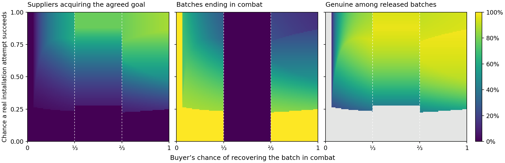

# When is a promise to change goals worth trusting?

A buyer can reasonably trust a partner with a batch long before it can certify that the partner acquired exactly the promised goal. In one factory a successful delivery earns the buyer four units over keeping its stock. A supplier that keeps the batch costs it two. **The buyer accepts when it puts more than one chance in three on delivery.** What makes a supplier actually change is a different question. Under its original goal, the extra work it can secure by becoming a reliable partner has to pay for the edit and for the goods it will later give up. Both calculations depend on who controls the next batch, who can check the goal and what happens after a refusal.

| Question | What changes the answer in the games studied |
| --- | --- |
| **When does the buyer gain confidence in the agreed goal?** | A reading must be more likely under the promised goal than under plausible alternatives, including capable imitators. Independent evidence that the tested controller will actually run the job can be more valuable than another favorable reading from the same bench. A dated reading also needs a reason to remain current. |
| **When do both founders sign despite real uncertainty?** | They sign when each prefers the whole risky agreement, including failed attempts and mistaken approvals, to its own available alternative. Insurance on a measurable physical risk can buy consent even when neither installation nor output is assured. More future work with the same partner can even justify knowingly losing on the first batch. |
| **When does deception pay?** | If an unchanged supplier sometimes gets the order and keeps extra goods, an expensive edit can be worth skipping. A genuine attempt can also fail. The two histories call for different responses. Access to affordable rework rewards disclosure of a real failure. An inspector who earns money from the next sale may also have its own reason to misreport. |
| **What does power change?** | When a rejected batch can safely return to both sides, the buyer can be selective and keep the peace. When a strong party can recover more by contesting, the same refusal can produce combat. A buyer can pay to limit what an inspection reveals about a weak partner, or pay for settlement terms that make that information safer to share. |

## A signature, an installation and a shipment

Imagine that Red initially values only red output, and Blue only blue output. Blue supplies a batch. If Red ships what it promised, this job produces four red units and six blue. Keeping the batch produces six red units and none for Blue. Returning the unused stocks leaves two units for each. The agreed new goal gives Red half a unit of weight for each blue unit. Its successor then prefers shipping, since four red plus half of six blue is worth seven by its new criterion. The original Red wants access to the order and decides whether that benefit pays for giving up the temptation to keep it.

The effort needed to change varies privately across factories. An attempt succeeds four times in five. A commissioning check passes nine in ten actual changes and one in ten retained goals. At equal physical strength, on the equilibrium where Blue buys the check, **80% of suppliers try, 64% acquire the agreed goal, 16% fail honestly and 20% knowingly skip the promised procedure.** Among positive readings, 16 in 17 controllers really have the agreed goal. Among negative readings, about 16% are genuine installations, 37% are honest failures and 46% are deliberate false claims. An inspection of the *active goal* can inform a release decision while leaving the cause of a mismatch unresolved. [The factory, payoffs and posteriors](../notes/206-when-a-truthful-attempt-can-fail.md)

A buyer who values the work can create some of the conditions that make honest effort worthwhile. It can reserve a witnessed production test, compensate a supplier for giving up the right to show only its best result, or pay an independent inspector. The supplier can also buy supervised completion after an unsuccessful attempt. When the groundwork from an honest attempt makes completion cheaper, admitting failure gives that supplier a profitable second chance. Where the same repair is cheap for everyone, an initially insincere supplier may also buy a genuine change. What the customer can learn about yesterday's promise depends on which repairs it offers today. [Honest admission and repair](../notes/212-who-would-admit-an-unsuccessful-update.md) · [Buying access to the full trial record](../notes/218-who-chooses-which-inspection-to-show.md)

## What uncertainty will both sides accept?

Consider two plants that can insure one another against different harvests. Each also decides whether to change its goal and help the other. Even a genuinely helpful plant can produce either two or four gift units. Each founder initially cares about its own stocks and assigns a greater cost to losing a unit in a bad harvest than in a good one. With no insurance, keeping a safe four units beats signing. When the parties can reserve **more than .894 units** to move from the lucky plant to the unlucky one, each strictly prefers signing and paying for the real attempt. Both actually change with probability **9/16**. The weather reserve pays for taking the risk each founder cares about most, while leaving considerable uncertainty about the other plant and its eventual delivery. [Risk preferences, insurance and both founders' consent](../notes/215-who-signs-when-even-a-correct-goal-has-an-uncertain-yield.md) · [Which risks a limited public meter can insure](../notes/216-which-risks-can-the-signers-share.md)

Even the *probability* of joint success can remain uncertain. In a second example each installer succeeds three times in four, but they share equipment and do not know how often they fail together. A suitably priced insurance agreement makes both prefer to try whenever they can justify a lower bound just above **55.75%** on both succeeding. With only the two individual success rates, the lower bound is 50% and no insurance on the available two outcomes meets both vetoes. Both will pay a scheduler to guarantee a shared working window often enough to bring the lower bound to 60%. [The joint-success threshold, the price of insurance and the scheduler](../notes/270-how-certain-must-the-partners-be-about-joint-success.md)

It also matters *which* wrong goal the buyer might get. In a three-grade production line, 60% acquire exactly the agreed preferences, 25% come to value the same grades but differ over risky batches, and 15% retain their old goal. Knowing how much output the near match could cost is enough for both founders to sign. A buyer who knows the three available recipes can accept an exact-match chance just above 42.5% if the total chance of either kind of change stays at 85%. [The cost of an imperfect match](../notes/287-how-much-a-buyer-can-lose-when-a-goal-is-only-approximately-right.md)

An order can also buy knowledge. At another factory, sending the first lot powers a readout that identifies the active controller. The customer knowingly loses 13/14 of a unit on that lot. By directing three later lots only to a genuinely changed supplier, it finishes **71/70 units ahead** after inspection. Five in seven suppliers pay to try, but the chance of a real change on that first lot is only 5/28. Continued access to the *same* partner makes the risk worth taking. [The cost of reserving the line](../notes/241-when-a-buyer-will-lose-on-the-first-order-to-learn.md)

## What a failed pilot tells the buyer

Suppose half the suppliers know the production method. The others can learn it, but the customer must pay for a lesson. With no trainer, a skilled supplier with unchanged goals delivers the small pilot because it wants access to the large order. A successful pilot identifies skill perfectly and tells the buyer nothing new about the goal. Once the buyer can profitably help failed pilots and give them the order too, a skilled unchanged supplier gains nothing by imitating. It keeps the pilot. A skilled supplier who really values its partner still delivers.

In the trained arrangement, among 439 proportionate failed pilots, **217 suppliers have the agreed goal and lack the skill, 186 tried honestly but failed to install the goal, and 36 made a false setup declaration.** The buyer spends .20 on a lesson worth about .37 per failed pilot. More founders now pay for a real installation. The genuine fraction per initial applicant rises from 36.5% to 62%. This diagnostic meaning depends on the follow-up offer. When help gets more expensive or skilled suppliers have another reason to make an impressive demonstration, some unchanged suppliers again serve the pilot. [The founders' incentives and the cost of training](../notes/245-when-helping-after-a-failed-pilot-makes-success-more-informative.md) · [When the buyer trains only some failures](../notes/246-how-skill-and-training-prices-change-what-a-pilot-means.md)

## How strong a claim can the evidence support?

Suppose the bargain promises that Red will value Blue's product, including on new jobs where helping Blue will cost it something. A useful test presents Red with two outcomes the original and agreed goals rank differently. Knowing which choice was feasible matters. Red may keep a batch because it cannot ship it, ship because it expects a reward, or treat a redirection of the batch as a change in its prospects. A procedure witnessed at noon answers a historical question. Trusting the same goal with work at dusk also requires a reason to believe the controller survived intact and still has the authority to act. [Testing preferences over lotteries](../notes/205-which-preferences-do-the-observations-identify.md) · [Why a successor would sell a reversal](../notes/223-would-a-genuinely-changed-agent-later-sell-a-reversal.md)

There is a positive case for **exact verification**. Imagine two controllers that read a sequence of deliveries, returns and project completions, update a finite table after each event, and score the final history. A buyer who can inspect the *actual operating table* and ground its labels in the same physical events can check whether it and the agreed table rank every lottery over these histories identically. Even when the programs have different numbers of states and use different numerical units, the calculation either proves agreement or exhibits two lotteries they rank differently. At most three short histories are needed for that counterexample. A record showing that the old controller ranked a lottery differently then establishes a genuine change. A post-installation proof alone can also find a partner who already had the right goal. The difficult premise is access to the acting evaluator and the meaning of its inputs. A record from a spare machine proves what the spare would do. [Comparing lottery rankings](../notes/286-checking-an-agreed-ordering-without-a-shared-utility-scale.md) · [Dating and attributing a change](../notes/244-which-changes-did-the-bargain-cause.md)

## How power changes a refusal

Physical strength matters because it determines what each founder can recover *after* saying no. Give Blue an 80% chance of recovering the usable material in a dispute, with the same four-in-five installation reliability as before. Every Red now pays for a genuine attempt. Among positive readings **36 in 37** suppliers have the agreed goal. Yet **26% of all encounters end in combat**. Eight percentage points are genuine changes wrongly flagged by the meter, and eighteen are honest installation failures correctly detected. Blue values the equipment it can recover. At equal strengths both prefer returning rejected stocks intact. If Blue's chance of prevailing falls to 5%, its alternative against an unchanged Red is so poor that it accepts a tested positive with only **38.65% confidence**. It also releases some batches untested, so only 19.35% of all released batches in that case have the agreed goal. These are outcomes on the most active trading equilibrium of the specified game. [Strength, recovered output and the three confidence calculations](../notes/207-who-can-walk-away-from-a-doubtful-installation.md)

Each point uses the same test and material payoffs. Moving right increases Blue's chance of prevailing. Moving up improves an honest installer's chance of success. The physical return option changes at the dashed lines. In parts of the upper region, greater installer skill lets Blue inspect less often. More of the entrusted work reaches a genuine supplier, while more unaltered suppliers also get past the check. A buyer can also purchase a funded payment on a rejected batch that makes return attractive to the stronger party. The new fallback can remove fighting after a refusal. [Derivation behind the figure](../notes/250-how-installation-reliability-and-physical-power-interact.md) · [A settlement the parties will fund](../notes/251-why-cheaper-checks-can-increase-or-reduce-combat.md)

Sometimes the danger comes from what a *rejection* reveals. In one market, failed installations are disproportionately at physically vulnerable sites. If the buyer insists on complete certainty for every accepted job, keeping every refusal peaceful lets it admit at most 59% of applicants, even though 75% really changed. At about **92% confidence** it can serve every genuine partner and keep the refusals peaceful too. The buyer takes a few uncertain orders, knowing what the certificate means. When a mistaken release spoils valuable stock, the best use of the same evidence leaves about 6.65% of offers contested. For the original owners, eliminating those last disputes is worth just under .10 resource units per offer. A .09 settlement facility wins both signatures. [Confidence and coverage](../notes/282-how-much-certainty-can-a-peaceful-market-afford.md) · [What the founders would pay for peace](../notes/285-when-founders-will-pay-to-remove-the-last-disputes.md)

Control can also make a powerful party pay to become more trustworthy. Consider two districts that can protect only one of them during a storm. Each initially values its own output. They will both try to give their representatives a common goal when each holds between roughly 37% and 63% of the appointments. At 80% northern control, the south vetoes the original terms. The north will pay to improve its own odds of adopting the common goal from 75% to 90% because the south will then authorize the project. Another workable bargain asks only the north to change. Among wrong decisions under the original fair rotation, **six in eleven** came from a genuinely impartial representative with a mistaken forecast. [Who would entrust a public decision to another district?](../notes/284-who-trusts-another-district-to-choose-under-an-uncertain-forecast.md)

## Which assurance would the parties build?

A buyer can reward sincere work separately from the risky outcome. Consider a process receipt saying that the installation procedure ran, plus a second reading of the resulting goal. In one example, giving the buyer both readings before handover yields genuine goals at 31% of suppliers. Delaying the goal reading leaves sincere failures eligible for some orders. Enough extra founders try that genuine installation rises to 47%. The buyer gains despite accepting less assurance about the individual it serves. **Full disclosure can also work.** A refundable buyer bond and a payment for documented effort preserve the 47% installation rate while getting more batches to genuine suppliers. If the market starts from distrust, a small funded payment for attempting even a rejected job can make trade worthwhile in every continuation of a signed contract. [Choosing when to read](../notes/263-when-suppressing-a-second-read-makes-both-founders-better-off.md) · [How much stock full disclosure needs](../notes/265-how-much-collateral-makes-full-disclosure-compatible-with-effort.md) · [Starting trade](../notes/268-how-a-buyer-can-start-trade-from-distrust.md)

Where the partners put their best installers also depends on what they can enforce. In one factory a bad handoff spoils one unit on an ordinary job and nine on a fragile one. Both founders pay to move reliable kits to fragile jobs, removing conflict while holding actual adoption at 75%. Once a funded guarantee can secure ordinary delivery on fragile jobs, both pay to move the reliable kits back. A genuine change now earns its keep on work the guarantee cannot reach. [Job assignment and the price of ordinary enforcement](../notes/289-when-it-pays-to-move-reliable-installers-to-high-stakes-jobs.md)

Real factories can share work, test imperfectly, reserve collateral and use common calibration standards. NIST describes customers and manufacturers using reference materials to compare their measurements. Whether a particular test measures a *terminal preference*, or whether a partner controls enough of its future stock to honor a guarantee, is a stronger premise. In one two-site model two customers will split the cost of calibrating a common meter even though neither would buy it alone. Where a cheap ordinary controller can guarantee the same delivery, the founders can choose it and preserve their old goals. Where it has the same price, reliability and authority as an edit, they can value either implementation equally. These results locate incentives and possible institutions. Estimating how often agents encounter them would require evidence about actual technologies, preferences and alternatives. [Industrial reference materials](https://www.nist.gov/programs-projects/measurements-standards-and-reference-materials-industrial-commodities) · [Who funds a calibration](../notes/266-who-will-pay-to-learn-what-a-shared-meter-means.md) · [Research map](../MAP.md)

I performed the project’s [AIM_BALANCE review](../AIM_BALANCE.md#4-end-of-task-review). Framing a failed test as evidence of deception risked overlooking partners who sincerely changed and lacked the skill to deliver. I checked the failed pilots against all three histories and included a public decision where even a genuinely impartial operator can forecast wrongly. Favoring goal change could also make an ordinary guarantee look artificially expensive. I gave the ordinary controller access to the same funds and evidence, and repriced a peaceful settlement against the best available use of the inspection. That narrowed what the founders would pay for the settlement. These are self-checked results about specified games. The frequency of affordable verification, lasting goal changes, and credible ordinary alternatives across real populations remains open. [Detailed review and frontier](../runs/r0008.md#end-of-task-aim-preservation-review)
